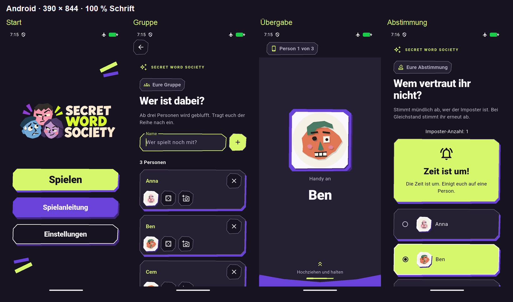
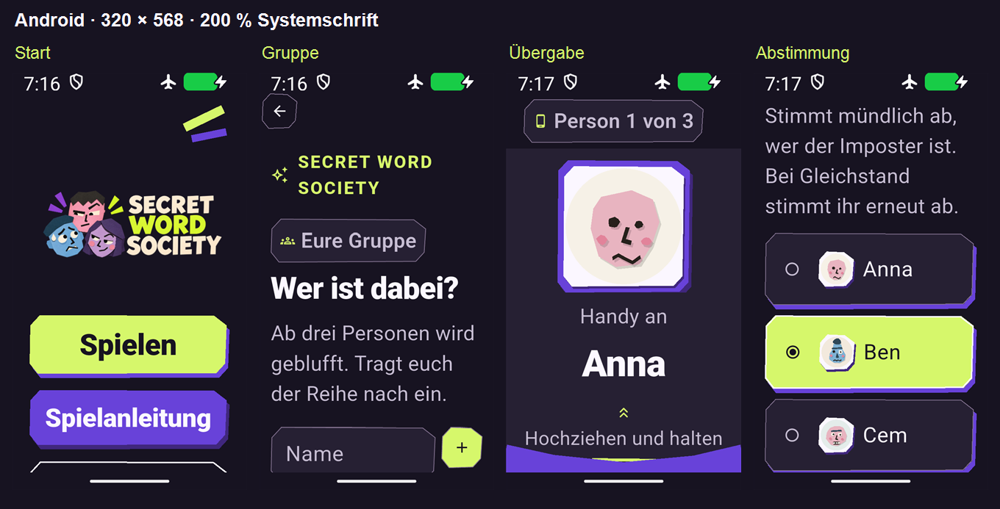

# Cutout-Gesamtprüfung (#92)

Prüfstand: 13.11.2026, App-Code von `b2f9ac6` nach Abschluss von #85–#91
mit der unten beschriebenen Korrektur der Foto-Rückaktion.
Die bestätigte Bildtafel und die Anforderungen aus #84 sind maßgeblich.
Diese Dokumentation hält technische Prüfung und gemeinsame visuelle Abnahme
getrennt: Bereitgestellte Bilder und erfolgreiche Tests ersetzen die Abnahme nicht.

## Gemeinsame visuelle Abnahme

**Offen.** Startseite, Gruppe, verdeckte Übergabe und Abstimmung werden zusammen
als tatsächliche Android-Aufnahmen vorgelegt. Eine Zustimmung des Nutzers ist
noch nicht dokumentiert. #92 und #84 bleiben deshalb offen.

Die Tafeln zeigen unveränderte Bildschirminhalte des Produktions-Releases;
für den direkten Vergleich wurden die Aufnahmen lediglich verkleinert und
nebeneinander angeordnet. Auf kleinen Displays scrollen Gruppe, Abstimmung
und Nebenansichten; die Tafeln zeigen jeweils einen Ausschnitt des Scrollwegs.
Die geschlossene Übergabe zeigt kein Geheimnis.

## Prüfumfang

| Anforderung aus #84 | Nachweis und Grenze |
| --- | --- |
| Gemeinsame Palette, Markenassets, Papierkonturen und Typografie | Vier Referenzsituationen sowie Spiel- und Nebenansichten gegen die bestätigte Richtung geprüft; vorhandene Logos und Figuren bleiben erhalten. |
| Lesbare Namen, Geheimnisse, Timer und Aktionen | Normale Darstellung (390 × 844, 100 %) und kleines Display (320 × 568, 200 % Android-Systemschrift); ergänzend bestehende Langnamen-/Wortumbruchtests. |
| Auswahl, Fokus, Druck, Laden, Fehler und deaktivierte Aktionen | Bestehende Start-, Gruppen-, Foto-, Abstimmungs- und Accessibility-Tests; Radio und Checkbox bleiben unterschiedlich. |
| Fotos und Avatare, optionale Effekte | Bestehende Foto- und Avatarprüfungen einschließlich Übernahme, Abbruch, Fehler und Erhalt in Folgerunden; echte Selfies bleiben Geräteabnahme. |
| Texte, Navigation, Sitzung und Spielregeln | Vollständige native Spieltests einschließlich beider Gewinner, Mehrfachauswahl, Gruppenänderung, Timer und Folgerunde. |
| Geheimhaltung, Vorhang und Unterbrechung | Bestehende Vorhang-/Übergabetests sowie native Abbruch- und Teilaufdeckabläufe; verdeckte Inhalte fehlen im öffentlichen Semantikbaum. |
| Touchflächen, Kontrast, Screenreader und Tastatur | Widget-Guidelines für Android-Touchflächen, beschriftete Ziele und Textkontrast; Semantik-/Tastaturtests für Spiel und Nebenansichten. Tatsächliche TalkBack-Ausgabe bleibt offen. |
| Reduzierte Bewegung | Bestehende Druck-, Avatar-, Vorhang- und Übergabetests; keine zusätzliche Bewegung durch die Gesamtprüfung. |
| Offline-Runde und Nebenwege | Android-Emulator mit deaktiviertem WLAN und mobilen Daten; Anleitung, Einstellungen, Datenschutz/Lizenzen sowie Foto-/Dialogwege geprüft. |

## Ergebnisse

Ein verbliebener Gestaltungsbruch wurde korrigiert: Der Fotoeditor verwendete
noch den unverzierten Standard-Zurück-Pfeil. Er verwendet nun dieselbe
Papierkontur und Fokusdarstellung wie Gruppe und Nebenansichten, weiterhin auf
dem nativen `BackButton`. Aufnahme, Effekte und Navigation bleiben erhalten.
Die vier Referenzsituationen der Tafeln sind von dieser Korrektur unberührt.

- Statische Analyse: ohne Befund.
- Vollständige Unit-/Widget-Suite: **184 Tests erfolgreich**.
- Native Spieltests auf Android API 36.1: **10 Tests erfolgreich** (6:08 Minuten
  Testausführung). Beide Gewinner, echte Timerabläufe, Überspringen/Abbruch,
  Teilaufdecken, Folgerunden, manuelle Imposter-Auswahl sowie sechs und vierzehn
  Personen einschließlich begrenzter Mehrfachauswahl sind enthalten.
- Native Fotopipeline: **1 Test erfolgreich** (16 Sekunden Testausführung),
  mitgelieferte Gesichtserkennung, sämtliche 38 Effekte und temporäre Bereinigung.
- Nach der Rückaktionskorrektur: alle **18 bestehenden Fototests**, Analyse und
  erneut alle **184 Unit-/Widget-Tests erfolgreich**.
- Produktions-Release-Build nach der Korrektur erfolgreich. Die zehn nativen
  Spieltests und die Fotopipeline wurden vor der ausschließlich die Rückaktion
  betreffenden Korrektur ausgeführt.
- Release-Sichtprüfung: Runde bis zur Folgerunde in beiden Anzeigegrößen,
  Anleitung bis zum Ergebnis, Einstellungen, Datenschutz, Lizenzübersicht und
  langer nativer Foto-Lizenztext einschließlich Scrollen und Rückwegen erfolgreich.
- Finale Kamera-Sichtprüfung nach der Rückaktionskorrektur in beiden Größen:
  Aufnahmehilfe, echte Emulator-Kameravorschau und Aufnahme, verständlicher
  Fehler bei fehlendem Gesicht, verweigerter Kamerazugriff, Abbrechen und
  erhaltener Name erfolgreich. Der native Zurück-Pfeil kehrt auch bei
  deaktivierten Systemanimationen zur unveränderten Gruppe zurück.
- Android-Fehlerlogs der Spiel- und finalen Fotoprüfung: ohne Flutter-Fehler
  oder Android-Absturzmeldungen. Flugmodus und deaktiviertes WLAN am Ende
  nochmals überprüft.

## Ausstehende Abnahmen

- Gemeinsame visuelle Zustimmung zu den vier Referenzsituationen und dem
  zusammenhängenden Designsystem.
- Physisches Android-Gerät, echte Selfies und tatsächliche TalkBack-Ausgabe.
- Beobachtete Erstspieler-Abnahme der Anleitung aus #17; durch das Theme
  und seine automatisierten Tests nicht ersetzt.

Fehlende Abnahmen sind keine bestätigten Fehler. Sie dürfen zugleich nicht als
erfolgreich geprüft oder durch den Merge einer Prüfungsdokumentation erledigt
markiert werden.
