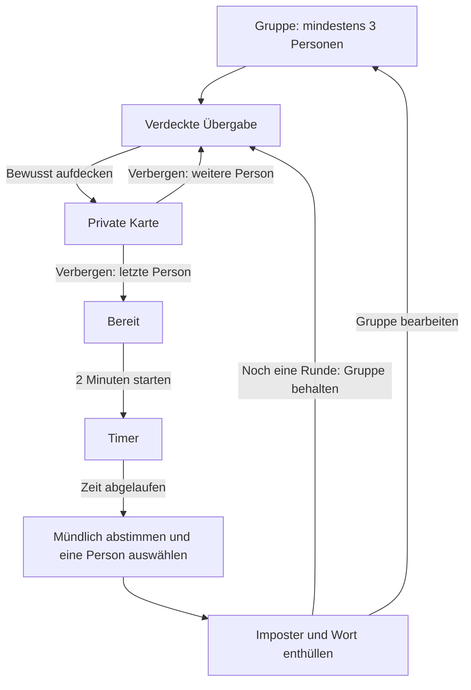

# Ticket 1 · Ablauf und visuelle Grundlage

Stand: 23.10.2026. Ergebnis von Ticket 1: ein spezifizierter MVP-Ablauf und ein
interaktiver Gestaltungsentwurf. Die Flutter-App bleibt bis zu den folgenden
Tickets auf ihrem bisherigen Stand.

## Entwurf ansehen

[Klickbaren Entwurf öffnen](prototype.html): Datei lokal in einem Browser öffnen;
keine Installation, Internetverbindung oder zusätzlichen Pakete erforderlich.
Die Navigation außerhalb des Handys springt zu einzelnen Ansichten. Dort lässt
sich auch die Zeit vorspulen. Im Handy kann eine vollständige Beispielrunde mit
Spieleranlage, verdeckter Übergabe, Abstimmung und beiden Ergebnissen durchgeklickt
werden. Feste Beispieldaten dienen der Gestaltung; sie sind kein Spielkern und
keine produktive Wortliste. Ohne JavaScript erscheint ein entsprechender Hinweis.

## Verbindliche Produktgrundlage

Vom Nutzer am 23.10.2026 bestätigt:

- Eine kostenlose Party-App, eine Gruppe an einem Handy, zunächst Android.
- Mindestens drei Personen. Genau ein zufällig gewählter Imposter pro Runde.
- Alle anderen erhalten dasselbe geheime Wort. Der Imposter erhält nur den
  dazugehörigen Hinweis und erfährt auf seiner privaten Karte seine Rolle.
- Nach der letzten geheimen Karte startet die Gruppe bewusst zwei Minuten.
  In dieser Zeit geben die Personen reihum Hinweise.
- Danach mündliche Abstimmung. Eine Person trägt die gemeinsame Verdächtigung ein.
  Bei Gleichstand wird erneut mündlich abgestimmt, bis eine Person feststeht.
- Richtiger Verdacht: Gruppe gewinnt. Falscher Verdacht: Imposter gewinnt.
  Keine zusätzliche Wort-Erraten-Phase.
- Vollständig offline. Gruppe bleibt für neue Runden in der laufenden Sitzung
  erhalten; nach einem App-Neustart wird sie neu angelegt.
- Deutsche Oberfläche und fertige deutsche Wort-Hinweis-Paare. UI-Texte und
  Wortdaten für spätere Sprachen getrennt organisieren, noch keine Sprachwahl.

## Bildschirmfolge und Texte

| Ansicht | Inhalt | Hauptaktion und Übergang |
| --- | --- | --- |
| Gruppe | „Wer ist dabei?“, Namen, Hinzufügen/Entfernen, Anzahl | „Runde starten“ ab drei Personen → erste verdeckte Übergabe |
| Übergabe | „Handy an {Name}“, „Nur du schaust auf den Bildschirm.“, Fortschritt „Person 1 von 4“ | „Geheimnis aufdecken“ → private Karte |
| Private Karte | Name, „Dein geheimes Wort“ + Wort **oder** „Du bist der Imposter“ + „Dein Hinweis“ + Hinweis | „Verbergen & weitergeben“ → nächste verdeckte Übergabe; bei letzter Person „Verbergen & weiter“ → bereit |
| Bereit | „Alle eingeweiht?“, kurze Aufforderung zum reihum Hinweisegeben | „2 Minuten starten“ → Timer |
| Timer | „Jetzt wird geblufft.“, 02:00 bis 00:00, „Gebt reihum einen Hinweis. Verratet das Wort nicht.“ | Bei Ablauf automatisch → Abstimmung |
| Abstimmung | „Wem vertraut ihr nicht?“, Namensauswahl, Hinweis auf mündliche Einigung/Gleichstand | „{Name} verdächtigen“ → Ergebnis; zuvor ohne Auswahl deaktiviert |
| Ergebnis | „Erwischt!“ / „Gut geblufft!“, Sieger, gewählte Person, tatsächlicher Imposter und Wort | „Noch eine Runde“ → erste verdeckte Übergabe mit derselben Gruppe und neu verteilten Geheimnissen |
| Ergebnis · Nebenaktion | „Gruppe bearbeiten“ | → Spieleranlage mit vorhandener Gruppe |

## Gestalterische Richtung · Geheimbund auf einer Party

Eigenständiger Vorschlag für dieses Projekt. Keine übernommenen Referenzgrafiken.
Dunkles Aubergine als ruhige Bühne, helle Texte, violette Karten und ein
limettengrüner Hauptbutton. Große, leicht versetzte Karten und kurze, spielerische
Texte vermitteln Partygefühl; Geheimnisse bleiben trotzdem gut lesbar.

| Token | Wert | Einsatz |
| --- | --- | --- |
| Hintergrund | `#171321` | App-Fläche |
| Oberfläche | `#262033` | Namenszeilen, Felder, Nebenaktionen |
| Kontur | `#63566F` | Felder und getrennte Flächen |
| Text | `#FBF7FF` | Überschriften und Inhalt |
| Sekundärtext | `#C6BDD2` | Bedienhinweise |
| Violett | `#6842D9` | Geheime Karte, visuelle Identität |
| Limette | `#D6F76B` | Hauptaktion und gewählte Person, dunkler Text |
| Koralle | `#FFAB91` | Fehler und Imposter-Ergebnis, dunkler Text auf Füllung |

- Android-Systemschrift Roboto; Browserentwurf nutzt vorhandene Systemschriften.
  Keine Netzabfragen für Schrift oder Bilder. Überschriften fett, maximal zwei
  Zeilen; Inhalt 16–18 sp, Namen/Geheimnis 28–36 sp, Timer etwa 72 sp.
- Abstände im 8-dp-Raster; 24 dp Seitenrand (16 auf schmalen Geräten), 16 dp
  Kartenabstand, Kartenradius 24 dp, Buttonradius 18 dp.
- Buttons und einzelne Namensaktionen mindestens 48 × 48 dp, Hauptbutton 56 dp
  hoch. Eine klare Hauptaktion je Ansicht. Bei wenig Platz vertikal scrollen.
- Keine feste Text- oder Kartenhöhe für Inhalte. Lange Namen umbrechen und auch
  bei 200 % Schriftvergrößerung sichtbar bleiben; Aktionslabels dürfen umbrechen.
- Status immer durch Text/Markierung erkennbar, nicht nur durch Farbe.
  Lesereihenfolge: Phase → Überschrift/Person → Inhalt → Hauptaktion.
- Sichtbarer Fokus im Entwurf; in Flutter semantische Labels für Entfernen,
  ausgewählte Person und Geheimnis. Timer nicht sekündlich vorlesen lassen,
  Phasenwechsel einmal ankündigen. Keine notwendige Animation, kein Blinken.

## Bedien- und Randfallentscheidungen für die Umsetzung

Die folgenden Details sind Arbeitsentscheidungen dieses Entwurfs, keine separat
vom Nutzer gewählten Regeln. Sie halten die nächsten Tickets eindeutig.

### Gruppe und neue Runde · Tickets 2–3 und 6

- Namen trimmen, Leerwerte ablehnen, doppelte Namen unabhängig von Groß- und
  Kleinschreibung mit Inline-Hinweis ablehnen. Keine willkürliche Spielerobergrenze.
  Bei weniger als drei Personen bleibt der Start deaktiviert und nennt den Grund.
- Reihenfolge entspricht der Namensliste. Für den MVP beginnt die erste Person
  mit den gesprochenen Hinweisen; keine automatische Sprechersteuerung.
- Neue Runde: neue zufällige Rollenverteilung und Wortauswahl, Übergabeindex 0,
  verdeckte Karte, keine Auswahl, Timer wieder 120 Sekunden und noch nicht gestartet.
  Derselbe Imposter oder dasselbe Wort kann zufällig erneut auftreten;
  Wiederholungsvermeidung gehört gegebenenfalls zu Ticket 7.
- Kein dauerhaftes Speichern von Namen oder laufenden Runden; keine Konten,
  Server, Fotos, Kategorien, Einstellungen oder Punkteverwaltung im MVP.

### Geheimnis und Rücknavigation · Ticket 4

- Aufdecken nur durch beschrifteten Button, kein zeitgesteuertes Aufdecken,
  keine versteckte Wischgeste. Wort und Hinweis verwenden dieselbe Kartenfläche.
- „Verbergen & weitergeben“ entfernt zuerst die private Information und wechselt
  anschließend atomar zur nächsten Person. Kein Zurück zur vorherigen Karte.
- Beim App-Wechsel oder Sperren wird eine sichtbare private Karte verdeckt.
  Bei Rückkehr bleibt dieselbe Person an der Reihe und muss erneut aufdecken.
- Android-Zurück während einer Runde verdeckt zuerst ein sichtbares Geheimnis
  und fragt dann „Runde verlassen?“ mit „Weiterspielen“ / „Runde verlassen“.
  Bestätigung beendet die Runde zur Spieleranlage, Namen bleiben erhalten.
  Abbrechen bringt nur die verdeckte aktuelle Ansicht zurück.
- Keine Geheimnisse in Routennamen, Logs, Wiederherstellungsdaten oder
  Accessibility-Bäumen verdeckter Ansichten. Für Ticket 4 Android-Schutz gegen
  Screenshots/App-Vorschau prüfen; die HTML-Vorschau bildet den nativen Schutz
  nicht ab. Der Prototyp schreibt keine Geheimnisse in Browser-History/Storage.

### Timer und Abstimmung · Tickets 5–6

- Bewusster Start auf der Bereit-Ansicht verhindert, dass die letzte Person Zeit
  verliert. Keine Pause und kein vorzeitiger Phasenwechsel als MVP-Bedienelement.
- Zeit gegen einen gespeicherten Endzeitpunkt berechnen, nicht durch Zählen von
  Tick-Ereignissen. Im Hintergrund läuft die Zeit weiter. Bei Rückkehr nach
  Ablauf direkt zur Abstimmung; kein Hintergrunddienst erforderlich.
- App-Prozess beendet: Sitzung verworfen, Neustart bei leerer Spieleranlage.
- Bei Ablauf kein Wort und keine Rolle zeigen. Eine Person wählt nach mündlicher
  Einigung einen Namen; Auswahl bleibt bis zur Bestätigung änderbar.
- Der Button nennt den gewählten Namen. Seine Betätigung enthüllt unmittelbar;
  kein weiterer Dialog. Gleichstand wird außerhalb der App erneut abgestimmt.

## Abnahme von Ticket 1

- [x] Bildschirmfolge bis zur Folgerunde einschließlich verdeckter Übergaben.
- [x] MVP-Regeln mit dem Nutzer geklärt und dokumentiert.
- [x] Farben, Typografie, Karten, Buttons und deutsche Kerntexte definiert.
- [x] Klickbarer Entwurf mit beiden Ergebnissen und Wiederholungsrunde vorhanden.
- [x] Randfälle für Namen, Rücknavigation, Unterbrechung und Timer spezifiziert.

Die visuelle Richtung ist ein reviewbarer Entwurf. Native Umsetzung, zufällige
Spielverteilung, Flutter-Tests und Android-Abnahme gehören zu den Folgetickets.

## Prüfstand

- JavaScript-Syntax und Ablauf in einer isolierten Node-Umgebung mit minimalem
  DOM-Modell geprüft: alle sieben Ansichten, Namensvalidierung und HTML-Escaping,
  Mindestzahl, Verbergen/Weiterreichen, App-Wechsel, Verlassen/Abbrechen,
  Timerablauf einschließlich Rückkehr, beide Spielausgänge und Folgerunde.
- Statische IDs und lokale Links geprüft; keine externen Ressourcen.
  Text-/Flächenkontraste der Palette rechnerisch mindestens 4,5:1.
- Visuelle Browserprüfung und Prüfung mit vergrößerter Schrift stehen aus:
  der lokale Vorschauzugriff war in dieser Umgebung gesperrt. Die oben
  beschriebenen Layout-/Accessibility-Ziele sind daher noch keine bestätigte
  Browser- oder Android-Abnahme.
- Kein Flutter-Produktcode geändert; Flutter-Analyse und Widget-Tests sind für
  dieses Entwurfsticket nicht erforderlich.
